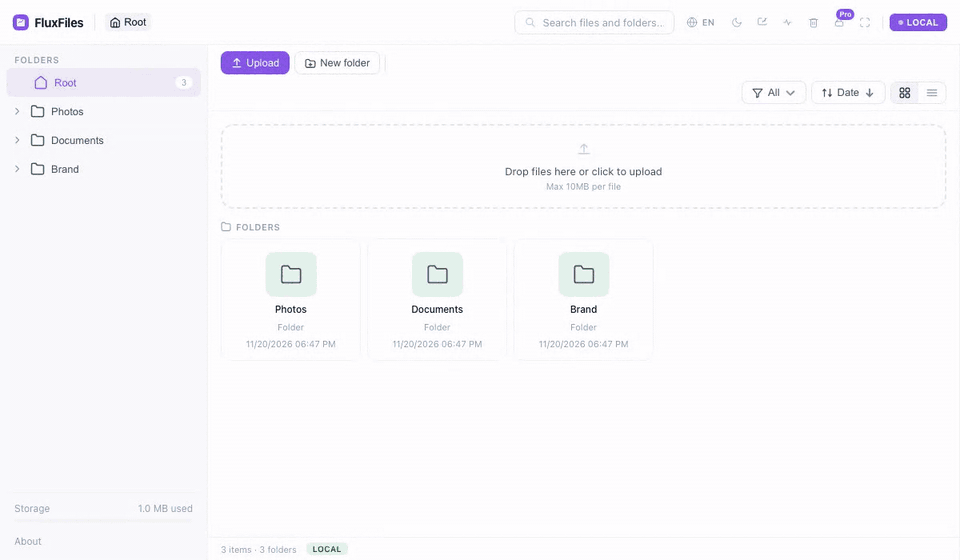

# FluxFiles

<p align="center">
  
</p>

[](https://packagist.org/packages/fluxfiles/fluxfiles)
[](https://github.com/thai-pc/fluxfiles/pkgs/container/fluxfiles)
[](https://packagist.org/packages/fluxfiles/fluxfiles)
[](https://github.com/thai-pc/fluxfiles/actions/workflows/test.yml)
[](LICENSE)
[](https://packagist.org/packages/fluxfiles/laravel)
[](https://www.npmjs.com/package/fluxfiles)
[](https://www.npmjs.com/package/@fluxfiles/react)
[](https://www.npmjs.com/package/@fluxfiles/vue)
[](https://www.npmjs.com/package/@fluxfiles/ckeditor4)
[](https://www.npmjs.com/package/@fluxfiles/ckeditor5)
[](https://www.npmjs.com/package/@fluxfiles/tinymce)
[](https://www.npmjs.com/package/@fluxfiles/summernote)
[](https://www.npmjs.com/package/@fluxfiles/node)
[](https://www.npmjs.com/package/@fluxfiles/mcp)
[](https://pypi.org/project/fluxfiles-token/)

**An embeddable file manager for PHP 8.1+.** Files stay on your own storage: local disk, AWS S3, Cloudflare R2 or SFTP. Your backend signs a short-lived JWT that decides what each user can see and do, so FluxFiles keeps no user database of its own.

- **Drop it into any app** with an iframe and a small JS SDK, or use the adapters for **Laravel**, **WordPress**, **React**, **Vue / Nuxt**, **CKEditor 4/5**, **TinyMCE** and **Summernote**.
- **Scoped per token:** disks, folder prefix, permissions, upload size, file types and quota are claims in the token, enforced on every request.
- **MIT core:** folders, trash, search, WebP/AVIF images, crop, zip, cross-disk copy and more. Paid add-ons are optional and separate.

**[Live demo](https://fluxfiles-demo.thai-pc.com/)** · **[Documentation](docs/guides/GUIDE.md)** · **[Website](https://fluxfiles.thai-pc.com/)** · **[WordPress plugin](https://fluxfiles.thai-pc.com/wordpress/)** · **[Pro add-ons](https://fluxfiles.thai-pc.com/pricing/)**

---

## Try it in 30 seconds

```bash
# One secret (>= 32 bytes), shared by this server and by whatever backend mints your tokens
echo "FLUXFILES_SECRET=$(openssl rand -hex 32)" >> .env
docker run -d --name fluxfiles -p 8080:80 --env-file .env ghcr.io/thai-pc/fluxfiles:latest
TOKEN=$(docker exec fluxfiles php -r 'require "/app/packages/core/embed.php"; echo fluxfiles_token(["user" => "demo", "perms" => ["read","write","delete"], "disks" => ["local"]]);')
echo "http://localhost:8080/public/index.html?token=$TOKEN"
```

Open the printed URL. The `?token=` URL is only for trying it locally; in a real app the SDK hands the token to the iframe, and it never appears in a URL.

**Before you embed it in an app, lock down who may use it.** Add your app's exact origin(s) (scheme + host + port, no path, comma-separated) to `.env`:

```bash
# CORS: which sites may call the API
FLUXFILES_ALLOWED_ORIGINS=http://localhost:5173
# CSP: which sites may frame the UI
FLUXFILES_FRAME_ANCESTORS=http://localhost:5173
```

`FLUXFILES_FRAME_ANCESTORS` falls back to `'self'` plus `FLUXFILES_ALLOWED_ORIGINS` when unset, but **if neither is set, no header is sent and any website can frame the FluxFiles UI.** Set them in production. See [CONFIG.md](docs/reference/CONFIG.md#4-server-env-vars-server-wide).

Your token-minting backend (Node, Python or PHP) must use the **same** `FLUXFILES_SECRET`, e.g. `node --env-file=.env server.js`. A token signed with a different secret is rejected.

No Docker? `composer require fluxfiles/fluxfiles`, then `php vendor/bin/fluxfiles serve` ([install guide](docs/guides/GUIDE.md#quick-start)).

## Embed it in your app

Two pieces: your backend mints a token for the signed-in user, and the page opens the picker with it.

```php
// Backend: who may do what, and where (PHP; Node, Python, Laravel and WordPress do the same)
// Uses the same FLUXFILES_SECRET as the FluxFiles server.
require 'vendor/fluxfiles/fluxfiles/embed.php';

$token = fluxfiles_token([
    'user'   => (string) $user->id,
    'perms'  => ['read', 'write'],
    'disks'  => ['s3'],
    'prefix' => "users/{$user->id}/",   // this user sees only their own folder
]);
```

```html
<!-- Page: load the SDK from your FluxFiles server and open the picker -->
<script src="https://files.example.com/fluxfiles.min.js"></script>
<script>
  FluxFiles.open({
    endpoint: 'https://files.example.com',
    token: '<?= $token ?>',
    onSelect: (file) => { document.querySelector('#cover').src = file.permanent_url || file.url; },
  });
</script>
```

<details>
<summary><b>React, Vue, Laravel, WordPress and rich-text editors</b></summary>

```tsx
// React: npm i @fluxfiles/react
<FluxFiles endpoint="https://files.example.com" token={token} disk="s3"
           onSelect={(file) => setCover(file.url)} style={{ height: 600 }} />
```

```vue
<!-- Vue 3 / Nuxt 3: npm i @fluxfiles/vue -->
<FluxFiles endpoint="https://files.example.com" :token="token" disk="s3" @select="onSelect" />
```

```blade
{{-- Laravel: composer require fluxfiles/laravel --}}
<x-fluxfiles disk="s3" mode="browser" height="600px" />
```

- **WordPress:** install the plugin ZIP from the [releases page](https://github.com/thai-pc/fluxfiles/releases?q=wordpress-v), then use *Media → FluxFiles*, the `[fluxfiles]` shortcode or the block. See [`packages/wordpress`](packages/wordpress).
- **TinyMCE (4–8), CKEditor 4, CKEditor 5, Summernote:** a toolbar button and the editor's own image-dialog "browse" button. See [Framework adapters](#framework-adapters).

</details>

All SDK options, events, commands and token refresh are covered in the [embedding guide](docs/guides/GUIDE.md#embedding-in-your-app). Moving off Responsive FileManager, RichFilemanager or KCFinder? The [migration guide](docs/guides/MIGRATING.md) maps their settings to token claims.

## Why FluxFiles

| You want… | FluxFiles |
|---|---|
| A different folder and rights per user, without a user table in the file manager | Every request carries a signed token with the user's disks, folder, permissions, quota and file types. Change what a user may do by issuing a different token. |
| Files on S3, R2 or an SFTP server, not on the web server | Local, S3, R2, any S3-compatible store and SFTP, with cross-disk copy and move. A tenant can even bring their own bucket (BYOB), with its credentials encrypted inside the token. |
| One picker across your stack | The same UI and token in the JS SDK, React, Vue, Laravel, WordPress and four rich-text editors. |
| A maintained replacement for an old picker | Responsive FileManager is archived on GitHub and RichFilemanager has had no commits since 2019. FluxFiles runs on PHP 8.1–8.5, with CI on every release. |
| An uploader *and* a manager | Unlike an upload widget (Uppy, FilePond), it also browses, renames, moves, trashes, searches and previews what is already stored. |

## Features

| | Included in the MIT core |
|---|---|
| **Files** | Upload (chunked, resumable tus, presigned), download, move, copy, rename, bulk select, trash with restore, zip and extract, import from URL, full-text search, duplicate finder |
| **Images and media** | WebP variants and on-demand WebP/AVIF at any size with `srcset`, crop, watermark editor, optimize at rest, EXIF/GPS stripping, image/video/audio/PDF preview |
| **Access** | JWT claims for disks, folder prefix, permissions, owner-only, quota, file count and file types; `role` presets; rate limits; HMAC-chained audit log |
| **Storage** | Local, AWS S3, Cloudflare R2, S3-compatible, SFTP, BYOB; bookkeeping in JSON files next to your files, or in your own MySQL/PostgreSQL/SQLite |
| **Admin tools** | Code/config editor, SFTP chmod, and bring-your-own terminal, PDF tools, office suite and e-signature in a modal |
| **UI** | 16 languages with RTL, dark mode, mobile layout, usage dashboard |

Pro add-ons, sold separately: share links, upload portals and document requests, versioning, webhooks, AI vision, OCR, virus scan, DLP, legal hold and retention, audit export, SSO, C2PA and backup. See [pricing](https://fluxfiles.thai-pc.com/pricing/). The full feature table, with when to use each feature, is in the [guide](docs/guides/GUIDE.md#features).

## Framework adapters

| Adapter | Install | What it does |
|---|---|---|
| [**Laravel**](packages/laravel) | `composer require fluxfiles/laravel` | `<x-fluxfiles>` Blade component, `FluxFiles::token()`, config, route proxy |
| [**WordPress**](packages/wordpress) | plugin ZIP | Media page, shortcode, block, Classic-editor button, settings for S3/R2/SFTP and AI tagging |
| [**React**](packages/react) | `npm i @fluxfiles/react` | `<FluxFiles>`, `<FluxFilesModal>`, `useFluxFiles()` (TypeScript) |
| [**Vue 3 / Nuxt 3**](packages/vue) | `npm i @fluxfiles/vue` | Components, composable, Nuxt plugin |
| [**TinyMCE**](packages/tinymce) | `npm i @fluxfiles/tinymce` | Toolbar button and image-dialog picker, TinyMCE 4–8 |
| [**CKEditor 4**](packages/ckeditor4) / [**CKEditor 5**](packages/ckeditor5) | `npm i @fluxfiles/ckeditor4` / `@fluxfiles/ckeditor5` | Toolbar button and the editor's image "browse" |
| [**Summernote**](packages/summernote) | `npm i @fluxfiles/summernote` | Toolbar button that inserts the picked file |
| [**JS SDK**](packages/sdk) | `npm i fluxfiles` or `/fluxfiles.js` from your server | The iframe + `postMessage` bridge the others build on |
| [**Node**](packages/node) / [**Python**](packages/python) | `npm i @fluxfiles/node` / `pip install fluxfiles-token` | Mint tokens from a non-PHP backend, byte-compatible with the PHP helper |
| [**MCP server**](packages/mcp) | `npx -y @fluxfiles/mcp` | Let an AI agent list, search and read files through a scoped token |

## Security in brief

- **Tokens:** HS256 only, short-lived, refused if they carry no `exp`; the main token travels over `postMessage` and `Authorization: Bearer`, never in a URL.
- **Scope:** every path is normalised and confined to the token's prefix; disks, permissions and file types are checked on every request.
- **Uploads:** dangerous extensions (including double extensions such as `shell.php.jpg`) are refused, an extension can't be changed after upload, and zip extract is guarded against path slip and zip bombs.
- **Network:** CORS and `Origin` allow-lists; BYOB endpoints and URL imports are SSRF-checked and pinned to the resolved IP.
- **Accountability:** an HMAC-chained audit log of every write, and rate limits per user and action.

The full list, token handling and a production checklist are in the [security section](docs/guides/GUIDE.md#security). To report a vulnerability, see [`SECURITY.md`](SECURITY.md).

## Documentation

| Read this | For |
|---|---|
| [Guide](docs/guides/GUIDE.md) | Install, configure, embed, storage disks, tokens, multi-tenant setups, API, troubleshooting |
| [Deployment](docs/guides/DEPLOYMENT.md) | nginx and Apache configs, permissions, upload limits, when to switch to the DB backend |
| [Configuration reference](docs/reference/CONFIG.md) | Every token claim and environment variable |
| [API](docs/guides/API.md) | Every route |
| [Migrating](docs/guides/MIGRATING.md) | Coming from Responsive FileManager, RichFilemanager, KCFinder, Roxy Fileman, Tiny File Manager or File Browser |
| [All documents](docs/README.md) | Guides, references, design and security records |

## Contributing

Bug reports and pull requests are welcome. The repository is a monorepo: core in `packages/core`, each adapter in its own package with its own tests. To run the core suite:

```bash
composer install -d packages/core
for f in packages/core/tests/unit/*.php packages/core/tests/integration/*.php; do php "$f"; done
```

More test suites (end-to-end, browser, adapters) are listed in the [guide](docs/guides/GUIDE.md#testing).

## License

[MIT](LICENSE). Created and maintained by **thai-pc**. If you fork or redistribute, please keep the copyright notice:

```
Based on FluxFiles by thai-pc — https://github.com/thai-pc/fluxfiles
```
